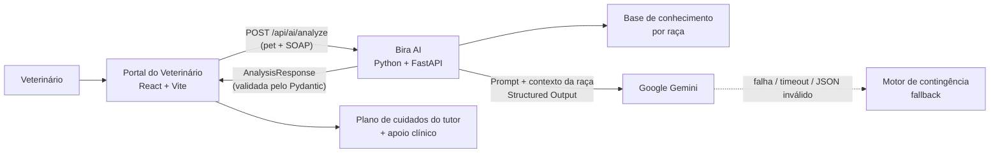

# 🐾 Bira AI — Microsserviço de IA Clínica Generativa (Sprint 4)

> **FIAP Challenge 2026 — Clyvo Vet** | **Disciplina:** Disruptive Architectures: IoT, IoB & Generative AI

---

## 👥 Integrantes

| Nome               | RM       |
| ------------------ | -------- |
| Arthur Graciani    | RM561728 |
| Gustavo Oliveira   | RM566358 |
| João Pedro Scarpin | RM565421 |
| Lucas Hideki       | RM565355 |
| Wesley Andrade     | RM563593 |

## 🔗 Links da Entrega

- 📹 **Vídeo da Sprint 4:** https://youtu.be/1lSNhto6c6I
- 📹 **Vídeo Pitch da Sprint 3:** https://youtu.be/Nh5_oaTWsOI
- 🐙 **Repositório GitHub:** https://github.com/Challenge-2026-EloVet/bira-ai-api

---

## 🎯 O problema e a solução

O momento de maior risco para a saúde do pet e para o negócio da clínica é a **saída da consulta**: o tutor vai para casa com muita orientação falada e pouca coisa por escrito. Isso causa descontinuidade no tratamento, ansiedade e evasão de clientes.

O **Bira AI** transforma as anotações clínicas da consulta (padrão **SOAP**: Subjetivo, Objetivo, Avaliação e Plano) em:

- **para o tutor:** uma mensagem acolhedora, um checklist de tratamento com horários e recomendações de prevenção ligadas à raça;
- **para o veterinário:** o diagnóstico provável resumido, o nível de risco epidemiológico e os exames sugeridos.

O veterinário **revisa o plano antes de enviá-lo ao tutor**. A IA apoia a decisão clínica, mas não substitui o profissional.

---

## 🏗️ Arquitetura implementada



**Fluxo:**

1. O veterinário finaliza a consulta no portal e as notas SOAP ficam estruturadas. *Nesta sprint a transcrição automática do áudio da consulta é simulada: as notas já chegam prontas.*
2. Ao clicar em _"Gerar Checklist de Cuidado para o tutor"_, o portal envia os dados do pet e o SOAP para `POST /api/ai/analyze`.
3. O Bira AI busca na base de conhecimento as predisposições da raça e verifica se o peso passa do limite preventivo.
4. Esse contexto é injetado no prompt e o Gemini é chamado com o schema `AnalysisOutput` como formato obrigatório de resposta.
5. A resposta é validada novamente pelo Pydantic. Se o Gemini falhar, estourar o tempo ou responder fora do contrato, o motor de contingência assume e a resposta sai com `origem: "fallback"`.
6. O portal exibe o plano para revisão do veterinário.

---

## 🧠 Decisões técnicas de IA

| Decisão | Como foi implementada | Por quê |
| :--- | :--- | :--- |
| **IA Generativa (LLM)** | Google Gemini via SDK `google-genai` | Traduz linguagem clínica em orientação leiga e acolhedora, adaptada a cada caso |
| **Structured Output** | `response_schema=AnalysisOutput` + `response_mime_type="application/json"` | O modelo é obrigado a responder no contrato que o portal consome |
| **Validação dupla** | `AnalysisOutput.model_validate_json(...)` (Pydantic v2) | Mesmo com o schema, a resposta é revalidada; se vier fora do formato, é descartada |
| **Restrições no prompt** | System instruction com papel definido e regra de seguir estritamente o Plano do veterinário, sem inventar medicamentos ou doses | Reduz o risco de alucinação clínica |
| **Grounding por raça** | `knowledge_base.py`: predisposições, peso-limite e diretriz preventiva por raça, injetados no prompt | Ancora a resposta em conhecimento curado e personaliza pela raça e pelo peso do pet |
| **Contingência** | `simulate_high_fidelity_output`: plano montado por regras a partir do SOAP e da base da raça | O tutor nunca fica sem orientação, mesmo com o LLM indisponível |
| **Rastreabilidade** | Campo `origem` (`gemini`, `mock` ou `fallback`) | O portal e o veterinário sabem de onde veio cada resposta |
| **Observabilidade** | Logs estruturados com JSON de entrada/saída, latência e tokens consumidos; `GET /health` informa o modo ativo | Facilita depuração e acompanhamento de custo |
| **Humano no loop** | O plano é exibido ao veterinário antes do envio ao tutor | Responsabilidade clínica permanece com o profissional |

> **Sobre a base de conhecimento:** a Clyvo está construindo uma base de conhecimento sobre os animais. O `knowledge_base.py` simula essa base com 3 raças (Dachshund, Golden Retriever e Shih Tzu). Nomes de raça são normalizados (`"shih-tzu"`, `"Shih Tzu"` e `"shih tzu"` viram a mesma chave).

---

## 📊 Resultados e validação

### Inferência real com o Gemini (demonstrada no vídeo)

Caso **Thor** (Dachshund, 4 anos, 9 kg, suspeita de hérnia de disco), enviado pelo portal:

- resposta com `origem: "gemini"`, aderente ao schema e exibida no portal;
- **risco ALTO**, justificado pela predisposição da raça a doença do disco intervertebral e pelo peso acima do limite preventivo de 8,5 kg;
- checklist de tratamento fiel ao Plano do veterinário (repouso, analgesia conforme prescrição, radiografia, retorno em 48 h), com horários em linguagem leiga;
- prevenção personalizada (evitar saltos e escadas, controlar o peso até 8,5 kg).

> O texto gerado varia a cada inferência; a estrutura da resposta é sempre a mesma.

### Testes do motor de contingência e da validação de entrada

Os cenários abaixo foram executados diretamente sobre `simulate_high_fidelity_output` e os schemas Pydantic (comportamento determinístico, sem chamar o Gemini):

| # | Cenário | Resultado obtido |
| :-: | :--- | :--- |
| 1 | Dachshund, 9 kg (limite 8,5 kg) | Alerta de peso ativado → risco **ALTO**; "Solicitar radiografia da coluna" separado como exame; 3 tarefas de tratamento extraídas do Plano; 3 recomendações de prevenção da raça |
| 2 | Golden Retriever, 30 kg (limite 36 kg) | Sem alerta de peso → risco **MÉDIO**; radiografia de quadril como exame; prevenção específica da raça (pisos escorregadios, condroprotetores) |
| 3 | Raça grafada `"shih-tzu"`, 8 kg (limite 7,5 kg) | Raça reconhecida pela normalização → alerta de peso → risco **ALTO**; prevenção de olho seco e calor |
| 4 | Vira-lata (raça fora da base) | Sem contexto específico → risco **MÉDIO**; prevenção genérica ("check-ups preventivos e vacinação em dia") |
| 5 | Payload sem o bloco `soap` | Rejeitado (`soap: missing`) → **HTTP 422** |
| 6 | `peso_kg` com texto em vez de número | Rejeitado (`pet.peso_kg: float_parsing`) → **HTTP 422** |

**Comparação Gemini x contingência:** com o Gemini, o checklist traz frequência e horário específicos (ex.: "24 horas por dia durante 14 dias") e a mensagem ao tutor é personalizada. Na contingência, o horário é genérico ("Conforme orientação do veterinário") e o diagnóstico repete a avaliação do SOAP. A diferença mostra o ganho real da IA generativa, enquanto a contingência garante disponibilidade.

### Limitações conhecidas

- A base de conhecimento cobre apenas 3 raças; as demais recebem orientação genérica.
- O motor de contingência classifica o risco apenas como ALTO ou MÉDIO (nunca BAIXO).
- O LLM pode variar a redação entre execuções; por isso a revisão do veterinário é obrigatória.
- A transcrição automática do áudio da consulta é simulada no portal.

---

## 🗺️ Planejado na Sprint 3 x implementado na Sprint 4

| Componente | Sprint 3 (proposta) | Sprint 4 (status) |
| :--- | :--- | :--- |
| Geração do plano de cuidados a partir do SOAP | Proposto | ✅ Implementado (Gemini + FastAPI) |
| Saída estruturada validada com Pydantic | Proposto | ✅ Implementado |
| Base de conhecimento por raça no prompt | Proposto (base epidemiológica) | ✅ Implementado (3 raças) |
| Integração com o Portal do Veterinário | Proposto | ✅ Implementado |
| Contingência quando o LLM falha | — | ✅ Implementado (adicionado nesta sprint) |
| Envio do plano ao tutor via WhatsApp e app | Proposto | 🔜 Próximo passo |
| Mensageria (RabbitMQ) para picos de demanda | Proposto | 🔜 Próximo passo |
| Histórico e logs de IoB em MongoDB | Proposto | 🔜 Próximo passo |
| Monitoramento contínuo de dados comportamentais (IoB) | Proposto | 🔜 Próximo passo |

Nesta entrega priorizamos o **núcleo de valor**: gerar, com segurança, o plano de cuidados a partir da consulta. Os demais componentes evoluem a partir desse núcleo.

---

## 🛠️ Tech Stack

- **API & Core:** Python 3.12+ | FastAPI | Uvicorn
- **IA & Schemas:** Google Gemini (`google-genai`) | Pydantic v2 | base de conhecimento por raça
- **Frontend consumidor:** Portal do Veterinário (React + Vite + TypeScript)

---

## 🚀 Como executar

```bash
# 1. Criar e ativar o ambiente virtual
python -m venv venv
source venv/bin/activate        # Windows (PowerShell): .\venv\Scripts\Activate.ps1

# 2. Instalar as dependências
pip install -r requirements.txt

# 3. Configurar as variáveis de ambiente
cp .env.example .env            # Windows (PowerShell): Copy-Item .env.example .env
# edite o .env e informe sua GEMINI_API_KEY (ou mantenha MOCK_KEY para o modo simulado)

# 4. Subir a API
uvicorn src.main:app --reload --port 8000
```

- **Swagger UI:** `http://localhost:8000/docs`
- **Health Check:** `http://localhost:8000/health` (informa o modo de IA ativo e o modelo)

> **Para ver a contingência funcionando:** com o serviço em modo Gemini, troque a `GEMINI_API_KEY` por uma chave inválida (ou use `GEMINI_TIMEOUT_MS=1`) e reinicie. A resposta passa a sair com `origem: "fallback"`.

### Variáveis de ambiente

| Variável | Padrão | Descrição |
| :--- | :--- | :--- |
| `GEMINI_API_KEY` | — | Chave do [Google AI Studio](https://aistudio.google.com/apikey). Sem ela (ou com `MOCK_KEY`), o serviço roda em modo `mock` |
| `GEMINI_MODEL` | `gemini-3.6-flash` | Modelo Gemini utilizado |
| `GEMINI_TIMEOUT_MS` | `30000` | Tempo máximo da chamada ao Gemini antes de acionar a contingência |

### Integração com o Portal do Veterinário

Com a API rodando na porta `8000`, suba o portal. A URL do Bira AI é configurável no portal pela variável `VITE_BIRA_AI_URL` (padrão `http://localhost:8000`).

---

## 📡 Endpoint principal: `POST /api/ai/analyze`

### 📥 Payload de entrada (pet + SOAP)

```json
{
  "pet": {
    "id": "ELO-1234",
    "nome": "Thor",
    "especie": "Cão",
    "raca": "Dachshund",
    "idade_anos": 4,
    "peso_kg": 9
  },
  "soap": {
    "subjective": "Tutor relata que Thor apresenta dor ao subir escadas e evita pular no sofá há cerca de três dias.",
    "objective": "Dachshund, 4 anos, 9 kg. Dor à palpação da região toracolombar, postura encurvada.",
    "assessment": "Suspeita de doença do disco intervertebral (hérnia de disco) em região toracolombar.",
    "plan": "Repouso estrito e restrição de escadas por 14 dias. Iniciar analgesia conforme prescrição. Solicitar radiografia da coluna. Retorno em 48 horas."
  },
  "veterinario": "Dra. Helena Costa"
}
```

> `veterinario` é opcional. Payloads inválidos (campos ausentes ou com tipo errado) são rejeitados com **HTTP 422** e a descrição do campo com problema.

### 📤 Resposta estruturada (`AnalysisResponse`)

> Exemplo ilustrativo: o texto gerado varia a cada inferência, mas a estrutura é sempre a mesma.

```json
{
  "diagnostico_provavel": "Suspeita de discopatia toracolombar agravada por sobrepeso (Dachshund, 9kg).",
  "risco_epidemiologico": "ALTO",
  "sugestoes_exames": ["Radiografia da coluna toracolombar"],
  "mensagem_acolhimento_tutor": "Olá! A Dra. Helena Costa cuidou com muito carinho do Thor hoje. Preparamos este guia para ajudar na recuperação dele:",
  "checklist_tratamento": [
    { "tarefa": "Manter repouso estrito e evitar escadas", "horario": "Contínuo por 14 dias" },
    { "tarefa": "Administrar o analgésico prescrito", "horario": "Conforme receita" },
    { "tarefa": "Levar o Thor para o retorno", "horario": "Em 48 horas" }
  ],
  "checklist_prevencao": [
    "Usar rampas para sofá e cama",
    "Controlar o peso para reduzir a carga na coluna"
  ],
  "origem": "gemini"
}
```

| Campo | Público | Descrição |
| :--- | :--- | :--- |
| `diagnostico_provavel` | Veterinário | Análise resumida do caso |
| `risco_epidemiologico` | Veterinário | `BAIXO`, `MÉDIO` ou `ALTO`, considerando raça e peso |
| `sugestoes_exames` | Veterinário | Exames adicionais sugeridos |
| `mensagem_acolhimento_tutor` | Tutor | Texto acolhedor em linguagem leiga |
| `checklist_tratamento` | Tutor | Tarefas do tratamento com frequência/horário |
| `checklist_prevencao` | Tutor | Cuidados de rotina ligados à raça |
| `origem` | Ambos | `gemini`, `mock` (sem chave configurada) ou `fallback` (contingência) |

---

_Elo Vet — Cuidar de quem amamos: é isso que nos une._ 🐾
