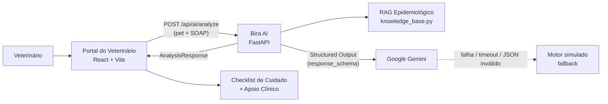

# 🐾 Bira AI — Microsserviço de IA Clínica & RAG (Sprint 4)

> **FIAP Challenge 2026 — Clyvo Vet** | **Disciplina:** Disruptive Architectures: IoT, IoB & Generative AI

---

Integrantes:

| Nome               | RM       |
| ------------------ | -------- |
| Arthur Graciani    | RM561728 |
| Gustavo Oliveira   | RM566358 |
| João Pedro Scarpin | RM565421 |
| Lucas Hideki       | RM565355 |
| Wesley Andrade     | RM563593 |

## 🎯 Objetivo da Sprint 4

Na Sprint 3 o **Bira AI** foi concebido como o motor de inteligência do ecossistema **Elo Vet**: contratos de dados, RAG epidemiológico e a abordagem de IA Generativa. Na **Sprint 4** o foco passa a ser a **execução funcional e integrada**: o microsserviço deixa de ser demonstrado isoladamente via Swagger e passa a ser consumido pelo **Portal do Veterinário (EloVet-Mock)** em um fluxo de ponta a ponta.

O Bira AI é responsável por:

1. **Interpretação SOAP:** Consumir as notas da consulta (_Subjetivo, Objetivo, Avaliação e Plano_) geradas no portal.
2. **RAG Epidemiológico:** Cruzar raça e peso do pet com regras científicas de predisposição médica.
3. **Structured Outputs:** Exigir do modelo um JSON no formato do schema Pydantic e validá-lo antes de responder.
4. **Handoff Tutor (IoB):** Traduzir a conduta médica em um checklist de cuidados acolhedor para o tutor.

---

## 🏗️ Arquitetura Implementada



**Fluxo:**

1. O veterinário finaliza a consulta no portal e as notas SOAP são estruturadas.
2. Ao clicar em _"Gerar Checklist de Cuidado para o tutor"_, o portal envia os dados do pet e o SOAP para `POST /api/ai/analyze`.
3. O Bira AI busca o contexto científico da raça (RAG) e chama o Gemini, exigindo o schema `AnalysisOutput`.
4. A resposta é validada pelo Pydantic. Se o Gemini estiver indisponível ou fugir do contrato, o motor simulado assume e a resposta sai com `origem: "fallback"`.
5. O portal exibe a mensagem de acolhimento, o checklist de tratamento com horários, a prevenção da raça e, para o veterinário, o risco, o diagnóstico provável e os exames sugeridos.


## 🛠️ Tech Stack

- **API & Core:** Python 3.12+ | FastAPI | Uvicorn
- **Motor de IA & Schemas:** Google Gemini (`google-genai`) | Pydantic v2 | RAG local por raça
- **Frontend consumidor:** Portal do Veterinário (React + Vite + TypeScript)

---

## 🚀 Como Executar

```bash
# 1. Criar e ativar o ambiente virtual
python -m venv venv
source venv/bin/activate        # Windows (PowerShell): .\venv\Scripts\Activate.ps1

# 2. Instalar as dependências
pip install -r requirements.txt

# 3. Configurar as variáveis de ambiente
cp .env.example .env            # Windows (PowerShell): Copy-Item .env.example .env
# edite o .env e informe sua GEMINI_API_KEY (ou mantenha MOCK_KEY para o modo simulado)

# 4. Subir a API
uvicorn src.main:app --reload --port 8000
```

- **Swagger UI:** `http://localhost:8000/docs`
- **Health Check:** `http://localhost:8000/health` (informa o modo de IA ativo e o modelo)

### Variáveis de ambiente

| Variável | Padrão | Descrição |
| :--- | :--- | :--- |
| `GEMINI_API_KEY` | — | Chave do [Google AI Studio](https://aistudio.google.com/apikey). Sem ela, o serviço roda em modo `mock` |
| `GEMINI_MODEL` | `gemini-3.6-flash` | Modelo Gemini utilizado |
| `GEMINI_TIMEOUT_MS` | `30000` | Tempo máximo da chamada ao Gemini antes de acionar o fallback |

### Integração com o Portal do Veterinário

Com a API rodando na porta `8000`, suba o portal. A URL do Bira AI é configurável no portal pela variável `VITE_BIRA_AI_URL` (padrão `http://localhost:8000`).

---

## 📡 Endpoint Principal: `POST /api/ai/analyze`

### 📥 Payload de Entrada (Pet + SOAP):

```json
{
  "pet": {
    "id": "ELO-1234",
    "nome": "Thor",
    "especie": "Cão",
    "raca": "Dachshund",
    "idade_anos": 4,
    "peso_kg": 9
  },
  "soap": {
    "subjective": "Tutor relata que Thor apresenta dor ao subir escadas e evita pular no sofá há cerca de três dias.",
    "objective": "Dachshund, 4 anos, 9 kg. Dor à palpação da região toracolombar, postura encurvada.",
    "assessment": "Suspeita de doença do disco intervertebral (hérnia de disco) em região toracolombar.",
    "plan": "Repouso estrito e restrição de escadas por 14 dias. Iniciar analgesia conforme prescrição. Solicitar radiografia da coluna. Retorno em 48 horas."
  },
  "veterinario": "Dra. Helena Costa"
}
```

> `veterinario` é opcional. Payloads inválidos (campos ausentes ou com tipo errado) são rejeitados com **HTTP 422** e a descrição do campo com problema.

### 📤 Resposta Estruturada (`AnalysisResponse`):

> Exemplo ilustrativo: o texto gerado varia a cada inferência, mas a estrutura é sempre a mesma.

```json
{
  "diagnostico_provavel": "Suspeita de discopatia toracolombar agravada por sobrepeso (Dachshund, 9kg).",
  "risco_epidemiologico": "ALTO",
  "sugestoes_exames": ["Radiografia da coluna toracolombar"],
  "mensagem_acolhimento_tutor": "Olá! A Dra. Helena Costa cuidou com muito carinho do Thor hoje. Preparamos este guia para ajudar na recuperação dele:",
  "checklist_tratamento": [
    { "tarefa": "Manter repouso estrito e evitar escadas", "horario": "Contínuo por 14 dias" },
    { "tarefa": "Administrar o analgésico prescrito", "horario": "Conforme receita" },
    { "tarefa": "Levar o Thor para o retorno", "horario": "Em 48 horas" }
  ],
  "checklist_prevencao": [
    "Usar rampas para sofá e cama",
    "Controlar o peso para reduzir a carga na coluna"
  ],
  "origem": "gemini"
}
```

## 🔗 Links da Entrega

- 📹 **Vídeo Demonstrativo da Sprint 4 (YouTube Unlisted):** _a definir_
- 📹 **Vídeo Pitch da Sprint 3:** `https://youtu.be/Nh5_oaTWsOI`
- 🐙 **Repositório GitHub:** `https://github.com/Challenge-2026-EloVet/bira-ai-api`

---

_Elo Vet — Cuidar de quem amamos: é isso que nos une._ 🐾
